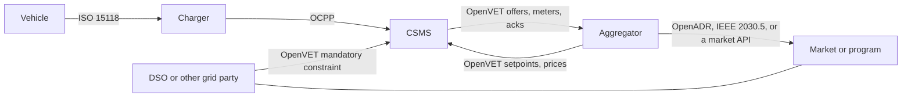

# Architecture

The picture is an explanation of [../spec/02-architecture.md](../spec/02-architecture.md). The spec wins if they disagree.

OpenVET is the edge between CSMS and aggregator, plus an optional constraint from the grid party to the CSMS. Everything else is labelled so a reader can see who already owns it.

A hub, if someone insists, sits on the OpenVET edges and can read the envelopes. It is not drawn because 0.1 does not define how a forwarded message keeps its sender. See the open questions.
