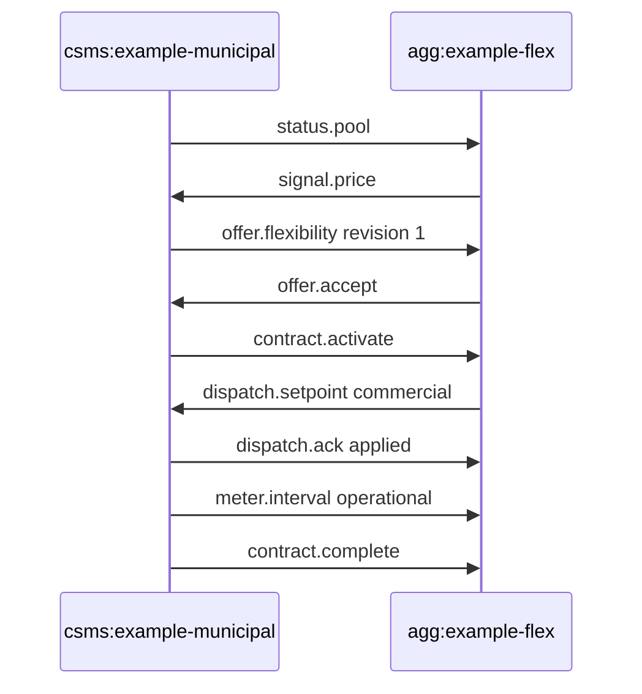
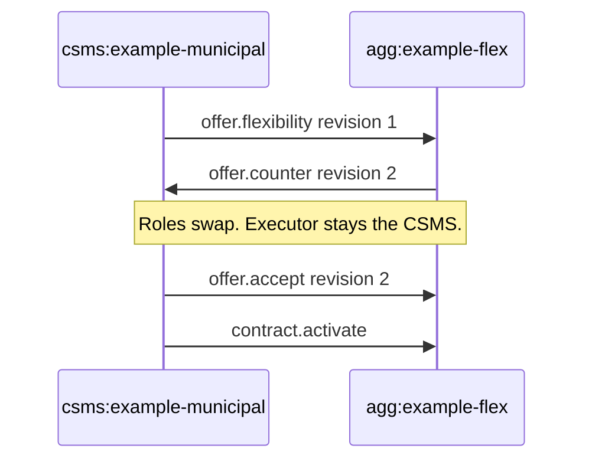
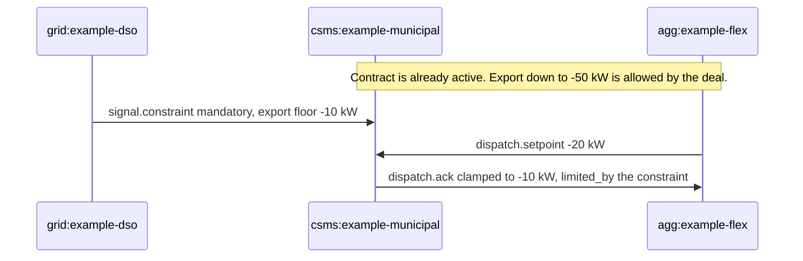

# Sequences

Normative rules are in [../spec/05-messages.md](../spec/05-messages.md). These diagrams are the same story, drawn so a review can point at a step.

Party ids used throughout: `csms:example-municipal`, `agg:example-flex`, `grid:example-dso`. The JSON trace for the first diagram is [../../examples/deal-happy.ndjson](../../examples/deal-happy.ndjson).

## A deal that completes

The meter in this sequence is operational. Nobody sends `settlement.claim`. That is the point of the example: telemetry is not an invoice.

## A counter-offer

The aggregator does not want the price. They send `offer.counter` at revision 2. They are now the offerer. The municipal CSMS is the counterparty and is the only one who can accept. The executor stays the CSMS.

## The feeder wins

A commercial discharge request that sits outside a mandatory constraint is clamped. The ack names the constraint. The CSMS does not "mostly follow" the aggregator.

## What does not happen

There is no sequence in which OpenVET talks to the vehicle, and none in which an operational meter becomes a settlement claim without a fiscal interval. Those omissions are specified.
